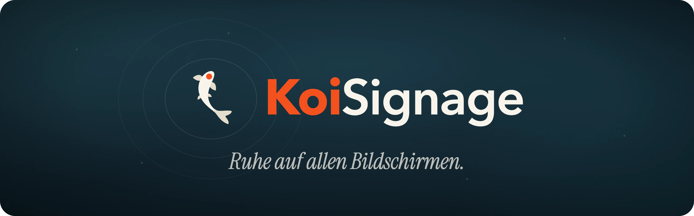

<p align="center">
  
</p>

<p align="center">
  <strong>Digital Signage für Betriebe ohne IT-Abteilung.</strong><br>
  Videos, Bilder und Webseiten zur richtigen Zeit auf jedem Bildschirm. Am Bildschirm genügt ein Browser.
</p>

<p align="center">
  <a href="LICENSE"></a>
  
  
</p>

## Was · Wann · Wo

Du legst fest, was läuft, wann es läuft und wo. Den Rest erledigt KoiSignage. Die Verwaltung ist bewusst ruhig und einfach gehalten: eine Seitenleiste, wenige Bereiche, keine verschachtelten Menüs.

**Was:** Videos, Bilder und Webseiten im Browser hochladen und mit Tags ordnen. Auf einer Zeitleiste wie im Videoschnitt werden daraus Sequenzen, mit Ebenen, Übergängen, Kürzen und Geschwindigkeit. Mastersequenzen reihen mehrere Sequenzen aneinander. Untertitel lassen sich mitliefern.

**Wann:** Regeln mit Wochentagen, Uhrzeiten und Zeiträumen, an jeder Ressource, Sequenz oder Stelle. Die Weihnachtsaktion endet am 26. Dezember von selbst. An jedem Eintrag steht, ob er gerade gilt.

**Wo:** Ein Bildschirm öffnet `/player/`, zeigt einen Code, und der wird in der Verwaltung eingegeben. Die Live-Ansicht zeigt, was jeder Bildschirm genau jetzt spielt. Fällt das Netz aus, spielt der Bildschirm aus dem Speicher weiter.

## Schnellstart

Voraussetzung ist Node.js ab 22.13. Es gibt keine Fremdpakete, also kein `npm install` und keine Datenbank zum Einrichten.

```bash
git clone https://github.com/marco-dsol/KoiSignage.git
cd KoiSignage
npm start
```

1. `http://localhost:8080/` öffnen und ein Admin-Passwort setzen.
2. Unter **Ressourcen** Videos und Bilder hochladen.
3. Unter **Sequenzen** eine Sequenz anlegen und die Ressourcen auf die Zeitleiste ziehen.
4. Am Bildschirm `http://SERVER:8080/player/` öffnen, den angezeigten Code unter **Bildschirme** eingeben und die Sequenz zuweisen.

Zum Ausprobieren genügt ein zweites Browserfenster als Bildschirm.

### Mit Docker

```bash
docker compose up -d
```

Datenbank und Medien landen im Ordner `./data`.

## Bildschirme

Der Bildschirm ist auf jedem Gerät dieselbe Webseite. Es wird nichts installiert, das Virenscanner stören könnte, und Updates kommen beim nächsten Laden von selbst.

| Gerät | So startet der Player |
| --- | --- |
| Raspberry Pi | [`clients/raspberry-pi/install-kiosk.sh`](clients/raspberry-pi/install-kiosk.sh) richtet Chromium im Vollbild ein und schaltet den Fernseher per HDMI passend zu den Betriebszeiten ein und aus. |
| Windows-PC | [`clients/windows/koisignage-kiosk.bat`](clients/windows/koisignage-kiosk.bat) in den Autostart legen. Die Datei startet nur Microsoft Edge im Kiosk-Modus. |
| Signage-Display, Android TV, Fire TV | Player-Adresse als Startseite eintragen oder in einer Kiosk-Browser-App öffnen. |

Der Offline-Speicher braucht HTTPS (oder `localhost`), weil Browser ihn nur in einer sicheren Umgebung erlauben.

## Videoformate

KoiSignage wandelt nichts um: Videos werden so gespeichert und abgespielt, wie sie hochgeladen werden. Länge und Vorschaubild liest die Verwaltung direkt im Browser aus. Damit jeder Bildschirm das Video abspielen kann, am besten **MP4 mit H.264** verwenden, in 1920 × 1080 (hochkant 1080 × 1920), mit 25 oder 30 Bildern pro Sekunde und Ton als AAC oder ganz ohne.

HEVC (H.265) vom Smartphone und MOV mit ProRes aus dem Schnittprogramm laufen in vielen Browsern nicht. Solche Dateien vorher umwandeln, zum Beispiel mit HandBrake (Voreinstellung „Fast 1080p30“) oder mit ffmpeg:

```bash
ffmpeg -i eingang.mov -c:v libx264 -preset slow -crf 21 -vf "scale=-2:1080" -pix_fmt yuv420p -c:a aac -b:a 128k -movflags +faststart ausgang.mp4
```

## Einstellungen

| Variable | Vorgabe | Bedeutung |
| --- | --- | --- |
| `PORT` | `8080` | Port des Servers |
| `HOST` | `0.0.0.0` | Adresse, an die der Server bindet |
| `DATA_DIR` | `./data` | Ordner für Datenbank und Medien |
| `ADMIN_PASSWORD` | leer | gibt das Admin-Passwort fest vor, die Änderung in der Oberfläche ist dann gesperrt |
| `MAX_UPLOAD_MB` | `4096` | grösste erlaubte Datei |
| `TRUST_PROXY` | leer | auf `1` setzen, wenn ein Reverse Proxy mit HTTPS davor steht |

Alles, was KoiSignage speichert, liegt im Datenordner: die Datenbank `koisignage.db` und der Ordner `media/`. Für ein Backup den Server kurz stoppen und den ganzen Ordner kopieren. Die Bildschirme spielen in der Pause weiter.

## Tests

```bash
npm test
```

## Lizenz

[MIT](LICENSE)
